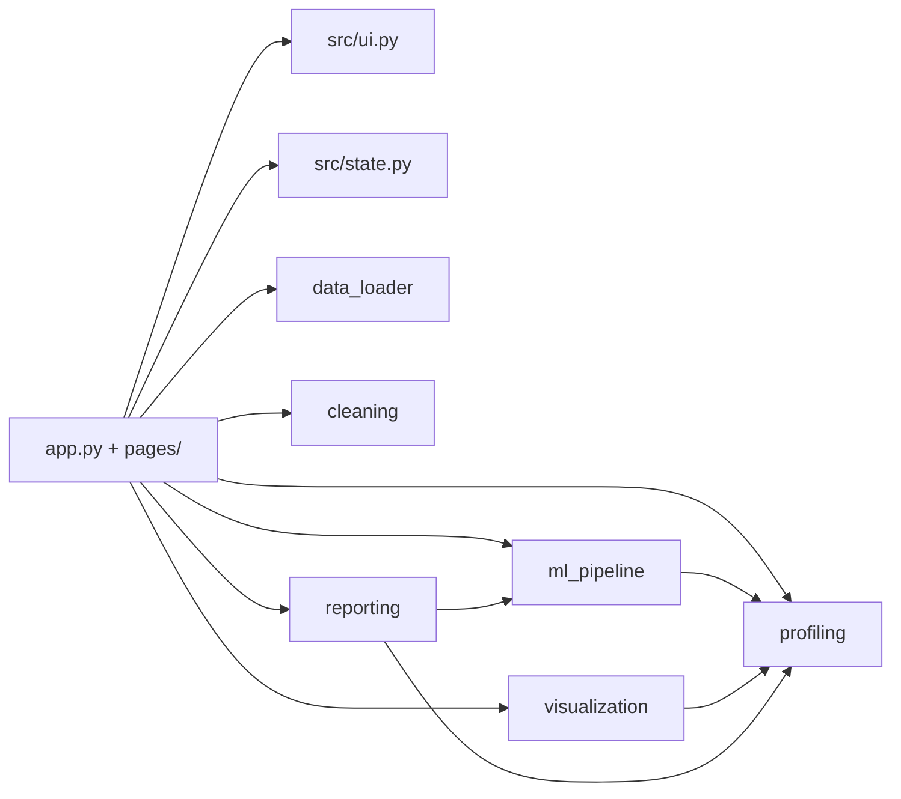

# DataPilot AI — Intelligent Data Science Workbench

A local-first Streamlit app: **upload → explore → clean → visualise → train models → compare → export a PDF report**, without writing code. Nothing leaves your computer.

## 1. Problem statement
Beginners often have a dataset but not the code skills (or time) to profile, clean, plot and model it correctly. Common mistakes — fitting preprocessing on test data, leaking the target, trusting accuracy on imbalanced classes — silently produce misleading results.

## 2. Objectives
- One accessible tool for the full workflow, running offline on a laptop.
- Leakage-safe ML by construction (split first, preprocessing inside a pipeline).
- Every number shown is computed from the data; recommendations are labelled as such.
- Tested core logic, clear documentation.

## 3. Main features
- CSV/XLSX upload with validation (extension, size, rows, encodings, blank/duplicate column names, ragged rows); three built-in sample datasets.
- Explore: metrics, column types, missing values, numeric/categorical summaries, IQR outliers, quality flags, per-column inspector.
- Clean: drop/fill missing (mean, median, mode, constant), blank→missing, remove duplicates, convert types, rename/drop columns, IQR outlier removal (explicit confirmation), preview before applying, audit log, undo (last 5 steps), reset with confirmation, CSV/XLSX download.
- Visualise: histogram, bar, scatter, box, correlation heatmap, line, pie; filters; aggregation; computed summaries; sampling notice above 20,000 points.
- Student Data Analysis: dynamic college attribute detection (District, City, Department, Academic Year, Gender, Category, Status); multi-criteria filtering (e.g., Pune district only) with AND logic and one-click reset; free-text search (Name, Roll No, PRN); headline cohort metrics; demographic breakdown charts (Bar, Pie); CSV & Excel export of matching records only; 100% non-destructive.
- ML Studio: classification (Logistic Regression, Decision Tree, Random Forest) and regression (Linear Regression, Decision Tree, Random Forest); accuracy/precision/recall/F1/balanced accuracy, confusion matrix, classification report; MAE/RMSE/R²; baseline comparison; feature importance (tree models); CSV and `.joblib` export.
- Reports: ReportLab PDF built locally from real values.

Not implemented (future scope): the optional rule-based data assistant, hyper-parameter tuning, cross-validation, persistent storage.

## 4. Technology stack
| Tool | Why |
|---|---|
| Python 3.12 | target runtime |
| Streamlit | UI without a separate front end |
| Pandas / NumPy | data handling |
| Plotly | interactive charts |
| scikit-learn | models, `Pipeline`, `ColumnTransformer`, metrics |
| SciPy | installed scikit-learn dependency (no direct use in the code) |
| ReportLab | local PDF generation |
| openpyxl | Excel read/write |
| joblib | model export |
| pytest | tests |

## 5. Architecture

| Module | Role |
|---|---|
| `config.py` | limits and constants |
| `data_loader.py` | safe parsing and validation of uploads |
| `profiling.py` | statistics, type inference, quality flags, correlations, insights |
| `cleaning.py` | pure cleaning functions returning a result + audit entry |
| `state.py` | original/working data, undo, versioning, stale-result invalidation |
| `visualization.py` | chart data preparation and Plotly figures |
| `ml_pipeline.py` | feature planning, leakage checks, training, metrics, export |
| `reporting.py` | PDF report |
| `student_filter.py` | student column detection, multi-criteria filtering, demographic insights & charts |
| `sample_data.py` | deterministic synthetic datasets |
| `ui.py` | shared Streamlit helpers and styling |

## 6. Workflow
Home (upload/sample) → Explore Data → Clean Data → Visual Analytics → Student Data Analysis → ML Studio → Reports. Results are tied to the dataset and data version; cleaning, undo, reset or loading a new file clears model results and reports so stale numbers are never shown as current. Filtering in Student Data Analysis is non-destructive and operates on views of the working data.

## 7. Installation (Windows, Python 3.12) — PowerShell
```powershell
python -m venv .venv
.\.venv\Scripts\Activate.ps1
python -m pip install --upgrade pip
pip install -r requirements.txt
python -m pytest -q
streamlit run app.py
```
If PowerShell blocks activation, call the venv's Python directly:
```powershell
.\.venv\Scripts\python.exe -m pip install -r requirements.txt
.\.venv\Scripts\python.exe -m pytest -q
.\.venv\Scripts\python.exe -m streamlit run app.py
```
(Alternatively: `Set-ExecutionPolicy -Scope CurrentUser RemoteSigned`.) The app opens at http://localhost:8501.

## 8. Sample datasets (`sample_data/`, regenerate with `python -m src.sample_data`)
| File | Content | Intentional defects |
|---|---|---|
| `student_performance.csv` | 615 rows; study hours, attendance, assignment/previous score, sleep; target `result` (Pass/Fail) | ~4% missing in `attendance_pct`, `assignment_score`, `sleep_hours`; 15 duplicate rows |
| `student_regression.csv` | 500 rows; numeric + categorical; target `final_score` | ~3% missing in `sleep_hours`, `parental_support` |
| `sales_data.csv` | 800 rows; date, product, region, units_sold, unit_price, revenue | none; `revenue = units_sold × unit_price` |
All data is synthetic (fixed seeds); no real people.

## 9. Using each page
- **Home** – upload a file or press *Load* on a sample. Warnings about the file (renamed columns etc.) are shown.
- **Explore Data** – tabs for preview, columns, numeric stats + outliers, categorical, missing values, quality issues, single-column inspector. A badge shows *Original* or *Cleaned* data.
- **Clean Data** – choose an operation, review the before/after table, press *Apply*. *Undo last step* and *Reset to original* (needs the confirm box) are at the top; download the result at the bottom.
- **Visual Analytics** – optional filters, pick chart type and columns; unsuitable choices show an explanation instead of a chart.
- **Student Data Analysis** – filter cohorts (e.g. Pune district, AIML dept, 2nd year), free-text search (name, roll no), demographic charts, and download filtered records as CSV/XLSX without altering the master dataset.
- **ML Studio** – target → task (suggested) → features (leaky/constant/ID columns removed with reasons) → models, test share, selection metric → *Train models*.
- **Reports** – *Generate PDF report*, then *Download*. A copy is also saved in `reports/`.

## 10. ML methodology
1. Rows with a missing target are removed and counted. 2. Features are screened (constant, all-missing, ID-like, datetime, >50 categories, leakage). 3. **Train/test split first** (stratified for classification when possible, fixed `random_state=42`). 4. A `Pipeline` of type coercion → median/most-frequent imputation → scaling (logistic regression) / one-hot encoding (`handle_unknown="ignore"`) → model is **fitted on the training rows only**. 5. All reported metrics are held-out test metrics; models use fixed defaults and are never tuned on the test set. 6. A majority-class / mean baseline is shown for context.

Metrics: binary classification reports precision/recall/F1 for the chosen positive class; multiclass uses weighted averaging. For imbalanced data, look at F1, recall and balanced accuracy, not accuracy alone. Regression: MAE and RMSE (lower is better), R² (higher is better; can be negative on test data).

## 11. Data-leakage prevention
Split before fitting; imputers/scalers/encoders live inside the pipeline; the target is never a feature; columns identical to, near-perfectly correlated with, or a one-to-one relabelling of the target are excluded with a warning; ID-like columns are excluded. This catches *obvious* leakage only — domain knowledge is still needed.

## 12. PDF export
Reports page → *Generate PDF report* → *Download PDF report*. Sections: title/date, dataset summary, columns, data quality, cleaning history, insights, ML configuration, model comparison, limitations. Sections without data say "not available". Fonts are Helvetica (Latin-1); other characters print as `?`. Charts in the PDF are simple bar drawings.

## 13. Tests
`python -m pytest -q` — covers loader, profiling, cleaning, state, visualization data logic, ML correctness (metrics recomputed independently, leakage, small data, invalid targets, reproducibility), PDF generation and the sample datasets end to end. Tests that render real Plotly figures are skipped when Plotly is not installed.

## 14. Known limitations
- State is in memory only: it is lost when the browser session or server stops.
- Only the first Excel sheet is loaded; limits: 50 MB, 500,000 rows, 1,000 columns (files above are rejected, never truncated).
- Fixed model settings, single split, no tuning or cross-validation.
- Leakage detection is heuristic. Feature importance is impurity-based.
- PDF uses Helvetica only (no non-Latin text).
- `.joblib` files are pickles: only load files you trust.

## 15. Troubleshooting
- *Activation blocked*: use the `.\.venv\Scripts\python.exe` commands above.
- *`py -3.12` not found*: install Python 3.12 from python.org and tick "py launcher".
- *Port busy*: `streamlit run app.py --server.port 8502`.
- *Upload rejected*: read the message (size, rows, malformed row, encoding); re-save as UTF-8 CSV or `.xlsx`.
- *Training says too few rows*: at least 30 usable rows are required.

## 16. Future enhancements
Rule-based data assistant, cross-validation and tuning, more models, multi-sheet Excel, saved sessions, embedded Plotly charts in the PDF.

## 17. Verification status
See `PROJECT_REPORT.md` §10 for exactly what was run and what was not.

## 18. Structure
```
app.py  requirements.txt  pytest.ini  README.md  PROJECT_REPORT.md  VIVA_QUESTIONS.md
.streamlit/config.toml
src/    config state data_loader profiling cleaning visualization ml_pipeline reporting sample_data utils ui
pages/  1_Explore_Data 2_Clean_Data 3_Visual_Analytics 4_ML_Studio 5_Reports
tests/  conftest test_data_loader test_profiling test_cleaning test_state test_visualization
        test_ml_pipeline test_reporting test_sample_data
sample_data/  assets/  reports/
```
